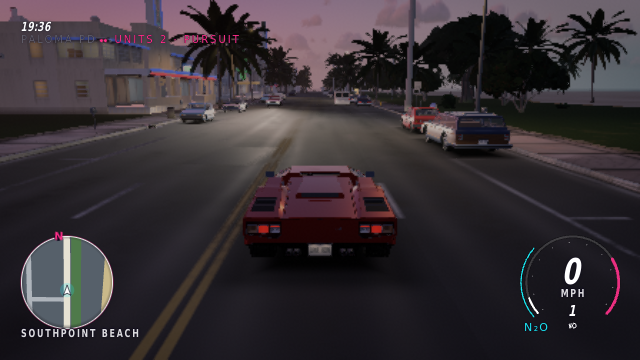

# Paloma PD

How the police of VICE '86 are built on the shipped release, rather than bolted next to it.

Everything below runs on the release's own systems: the **Paloma Engine** WebGL 2 renderer draws
every officer and cruiser, `game/lanes.js` and `game/drivers.js` decide where a car may drive,
`physics/index.js` (Rapier) is the only thing that moves a body, and `audio/` is the only thing that
makes a sound. Nothing was downloaded, and no renderer, physics library or model file was added.

## The unit

A patrol car is a traffic vehicle of the release's own `police` kind (the fleet sedan in
`vehicles/traffic/specs.js`, with its patrol-green wings, white doors and roof light bar). The
cruiser's body, its five-segment light bar and the driver behind the wheel are generated by the
traffic model builder in the model worker, exactly as a taxi's or a bus's are: `vehicles/traffic/kit.js`
primitives on a `Skin`, packed by `core/mesh.js`, shaded by `render/families/vehicle.js`.

The flash is the release's own shader path: `LIGHT_BAR_CODE = 4` added to a vehicle's indicator
code, which `vehicle.js` turns into alternating red and blue lens emission and which `game/lamps.js`
turns into the two glows and the roof wash. That much existed in the shipped code; what it lacked was
a reason to flash.

**The officer** (`vehicles/traffic/officers.js`) is authored the same way: lathed elliptical profiles
for torso, head and cap, rods for arms and legs, boxes for shoes, belt, tie, name tape and cap band,
a small brass disc for the badge — 32-segment rings at close range, 7 at a distance. They wear a pale
blue shirt, navy trousers, a dark peaked cap with a patent brim, and a gold badge on the chest; the
skin tone alternates. The same `drawOfficer()` builds the **driver baked into the cruiser**: seated,
hands forward, no legs, because the shell and the windscreen hide them.

`game/traffic.js` uploads one officer mesh, and gives each unit on an incident a dynamic object
through `renderer.addDynamic()`. Its pose is written with `core/math.js`'s `m4fromYawPos` at the
flat land height, with a half-centimetre bob while it walks. An officer has no collider and no
kinematic body: it is scenery that moves.

They ride, and they only get out where an officer would. An officer exists while their own car is
standing (under 2.2 m/s), within 150 m, and has not been shoved out of place; at a traffic stop —
the player waiting with a unit after them — one walks across to the driver's door out to 60 m, and
walks back to its own car when the call is over. Nothing chases a cruising car on foot: a unit that
pulls away, a unit that has been hit, or a unit that is simply too far off releases its officer at
once, so the object goes back to the renderer rather than standing in the middle of the beat. It can
be driven through, which the geometry makes obvious: it is short, thin, and does not stop anything.

## The dispatch (`game/police.js`)

The dispatch owns no vehicles. Every 0.45 s it looks at the units that already exist and decides
three things.

**Can they see you.** `canSee` casts one Rapier ray from the camera to the cruiser's roof line. The
player's own car is excluded from that cast; a wall, a pillar or a van between you and the officer
blocks the view. `witness` is the answer when a unit is within 95 m, `contact` within 155 m.

**Whether anything happened.** A witnessed speed over the posted limit of the lane you are on
(sustained 1.25 s), a collision you caused that an officer could see, or a collision with a patrol
car — that last one is news wherever it happens, because the unit reports its own accident. Heat
rises while you keep it up, to three at most, and each step up asks dispatch for another unit.

**Who goes where.** Units are ordinary drivers, so they are ordered by giving a driver a route:
`TrafficSim.setRoute(driver, route)`, where `route` is a `Map` of lane → next lane computed by one
breadth-first search *backwards* over the graph from the lane you were last seen on (`routesTo`,
at most 900 lanes). A search is shared by all units, computed at most once per sighting. Only legal
successors appear in it, so a unit crosses junctions by asking for a grant like everyone else, waits
at red like everyone else, and never drives through a building because nothing tells it where to go.
A lane the route does not know leaves the driver's own weighting in charge, so a unit is never
stranded by an order. Ordered units run their bars; the ones that arrived on a call (`ON_CALL_SHARE`,
the release's own one-in-three) run them anyway.

**When it is over.** A unit within 22 m of you while you are under 1.1 m/s for 3 s ends it as a
*traffic stop* — officers walk to your driver's door, then back to their cars. Out of sight for 1.5 s
the mode becomes `search`, they keep coming to the last place you were seen; out of sight for 12 s
the search is called off. Every one of those clocks is measured in simulated time (`game/loop.js`
hands the streets a fixed 120 Hz step and stops keeping up below twelve frames per second), so a
slow machine slows the police down with everything else instead of making them give up early. There is no health bar, no arrest, no wanted stars and no respawn penalty:
this is a 1986 street, and the sanction is a stop.

The HUD carries one line of it, under the clock: `Paloma PD · units 2 · pursuit`, with three pips for
heat. Dispatch speaks through the game's own `ui.toast`. The wail is `audio/siren.js`: a saw at 830 Hz
 frequency-modulated by a 0.58 Hz sine through a band-pass, panned by the audio module's own
`panOf`, built when the level rises and disposed when it falls.

## Where it hooks in

| Place | What the fork added |
| --- | --- |
| `game/traffic.js` | `PatrolDispatch`, the beat minimum, roof bars per state, officers on foot, the impact subscription. |
| `game/drivers.js` | `setRoute`, and a route-aware `_chooseRoute`. |
| `game/game.js` | `notify` (toasts), `police.enabled` by phase, the siren feed, the reset in `placeCar`. |
| `game/hud.js`, `ui/hud-model.js`, `ui/hud.js`, `style.css` | the one line and three pips. |
| `game/automation.js`, `render/index.js` | `window.__vice.police()`, `.dispatch(n)`, `.engine`; `renderer.engine`. |
| `index.html`, `ui/wordmark.js` | the engine's name under the wordmark. |

The beat is deliberately a small addition to the traffic the player asked for, not part of it:
`MOVING_BY_DENSITY` stays what it was, and one cruiser at traffic 1 and two above it are added on top
and kept until they are more than 260 m away. A cruiser may be placed nearer than ordinary traffic
(95 m rather than the spawn distance the traffic uses) but never in view, so the streets are never
empty of police without one appearing on the hood of your car. At traffic 0 there is no police force,
because there is no traffic.

## Testing

`test/game/police.test.mjs` (13 cases, `node --test`) covers the judgements — that a route only
names legal successors and reaches across a junction connector, that an unseen excess of speed is not
an offence, that a struck patrol car is, that a directed driver drives the route and stops on the
goal lane **over a real `prepareLaneGraph()` network and the real driver model**, that the order is
handed back when the stop ends, that a lost suspect becomes a search and then nothing, that no
policing happens on the title, in the garage or while paused — and that the officer's mesh is a
1.8 m person with feet on the ground and one shader family, not a blob.

`tools/browser-check.mjs` boots the real page headlessly on SwiftShader and reports errors, missing
requests and what the dispatch and the HUD say. The two divide the work deliberately. A software
renderer runs the streets at a fifth of real time, so the browser check is there to prove the wiring —
that the units exist, that an ordered incident finds witnesses, that `2/2` are answering and the HUD
line and its pips light up with them — and it never waits for a car to drive anywhere. That the cars
actually drive, reach the sighting and hand the order back when the stop is over is the Node case's
job, which runs the same driver model in milliseconds.

